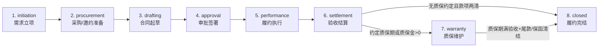

# 合同模块全生命周期与监督报送完善设计

状态：现行设计及复核修复执行基线（2026-11-13）。T-10～T-12 已发布 V70，复核修复追加 V72，工程证据与发布状态见 [修复记录](../docs/contract-lifecycle-repair-2026-11-13.md)。签约前智能法审一期（T-9）已发布至生产 V67，其规则与三态结论契约唯一维护于 [智能合同法审一期设计](contract-legal-review.md)。

---

## 1. 模块总体定位与产品边界

`newfc` 合同模块覆盖公司及所属单位全部经济合同（支出类与收入类）的全生命周期管控，**不另建第二套项目立项审批系统或泛微 OA 多级会签流**，核心定位为五位一体闭环：

1. **立项预算衔接与全口径合同底座**：通过关联 `md_project`、综合计划 `plan_item`、项目预算 `pb_entry` 与投资四算 `ic_project` 实现事前额度把关；通过结构化登记决策/采购过程要素与审批凭据附件实现准入门禁，同时完整承载上级监督报送所需的全部签约、授权与审签元数据。
2. **签约前智能法审（衔接 T-9）**：在“合同起草 / 审批签署”阶段执行确定性要素与制度校验、范本条款比对及模型语义审查，绑定正文与签订依据指纹；持续推进候选范本转正与历史样本配对验收（`AC-CLR-09`）。
3. **结算与收付分离刚性控制**：区分工程/进度价款结算（含扣回预付款、质保保留金、违约考核扣款）与实际资金收付；落地公司/直属电站 50 万元分级付款审批与 500 万元大额资金集体决策核验，建立收入合同正向收款与开票闭环。
4. **履约、变更索赔、中止解除、担保质保与纠纷闭环**：统一纳管有金额变更、0 金额商务/工期变更、承包人与发包人索赔、中止与恢复履行、合同解除清算、保函/保证金/工程保险、质保期满验收签证及仲裁诉讼备案。
5. **内外部双口径标准报送与协同监督接口**：实现“一次录入、三处输出”——① 每月 28 日前公司内部 5 表合同月报；② 上级《纪巡财审合同导入》6 张 Excel 表 + 4 类分级附件目录树 ZIP 报送包；③ 面向公司泛微 OA 纪巡财审统一门户的全量/增量只读统计接口（源系统保留数据主权，OA 仅展示不回写）。

---

## 2. 制度依据与外部报送标准

受控原件、官方导入模板及脱敏实务样表保存在 `docs/private/contract-legal-review/` 与 `docs/private/contract-lifecycle/`（仅作本地/服务器离线开发核对参考，运行时不直接读取，不入公开 Git）。

| 类别 | 制度 / 标准文件 | 效力与核心约束 |
|---|---|---|
| 合同主制度 | 湘澧制〔2026〕17号《合同管理办法》（`L-QJ03-04-2026`，2026-06-25 印发） | 全过程闭环（2.3）；7 类业务分类（3.2）；承办人动态交接（4.10.4）；三类签订依据（第 5 章）；编号与`补X`（7.2/附件 3）；重要合同法审与三重一大（6.3/7.3）；未生效禁履行（8.1）；签署后 10 个工作日扫描上传分发（8.2）；应急项目 15 个工作日补批（8.7）；变更/索赔分级与禁拆包规避采购（第 9 章/附件 4～7）；中止解除与担保方同意（第 10 章）；纠纷备案（第 11 章）；档案完整方可验收结算及质保验收（第 12 章）；结算支付分离与 50 万元分级审批（第 13 章/附件 8）；每月 28 日台账报送与 2 个工作日异常报告（第 15 章/附件 9～11）；档案移交（第 16 章）；资金进项合同签约主体与 10 个工作日报备（第 17 章） |
| 采购制度 | 湘澧制〔2026〕20号《采购管理办法》（`L-QJ02-04-2026`） | 施工（300/100 万）、货物（150/50 万）、服务（100/30 万）三级阈值；公开/邀请招标、谈判、询比、竞价、直接采购及 ≤3 万元单一无后续服务直接发票报账边界（8.1.7）；合同履约后评价与供应商库联动（13.2） |
| 法律事务制度 | 湘澧制〔2025〕3号《法律事务工作管理办法》 | 重要经济合同法审率 100%；范本合同样本审查；重大纠纷起诉/应诉审批与《诉讼（仲裁）案件情况统计表》17 列台账 |
| 计划与投资制度 | 《综合计划管理规定》（2023）、《投资管理规定》（湘澧制〔2021〕20号）、《基本建设财务规则》（财政部令第 81 号）、`SL/T 19—2023` | 合同金额+变更超计划须先办计划外审批（应急项目 5 个工作日补立项）；工程项目累计结算/合同额达批复概算 90% 黄色预警、100% 红色阻断；完工超 180 天未结算/未决算预警 |
| 资金、预算与印章 | 《资金管理办法》（`L-CW02-04-2023`）、《大额资金使用管理办法》（`L-CW00-11-2016`）、《预算管理规定》（`L-CW01-00-2016`）、《印章管理办法》（`L-XZ05-04-2023`）、《三重一大事项清单指标》 | 合同费用须银行转账至合同对方（资金办法 4.6）；保函押金建账与结项退回（3.2）；保函索赔/冻结 2 日内报告（9.3）；超预算支付提前 5 个工作日报批（6.3）；单笔 ≥500 万元或 ≥上年度净资产 1%（孰低）须集体决策会议文件与可研；合同专用章及法人授权委托书用印凭据（印章办法 4.3.3/4.3.7） |
| 上级定期填报标准 | 《纪巡财审合同导入》官方模板包（2026-11-10，8 个目录：收/支基本信息、执行与实际收付款、变更与纠纷、分级附件目录） | 强制校验总价/单价计价、20 种币种、支出资金来源（含关联收入合同）、三重一大决策与会议形式、采购起止时间链、双方签署人是否法定代表人及授权书、4 态执行状态、每次收付款最高审批人姓名/身份、0 金额变更及唯一补充协议号、严格编号目录树附件包 |
| 内部监督门户方案 | 《纪巡财审协同监督数据平台建设需求分析报告》（2026-11-10 财务部补充净版）及四部门联合复核意见 | 源系统保留数据主权，OA 门户通过全量/增量只读接口拉取合同、结算、累计已支付、累计变更及预警闭环统计；内置采购 15 条、合同 18 条、工程财会 11 条量化预警规则 |

---

## 3. 全生命周期状态机与正交维度重构

### 3.1 八阶段主状态机与五态运行状态

现行 7 阶段中，`initiation` 缺少计划/预算衔接，`archived` 将“结算完毕”“质保期满”与“档案移交”混为一谈（导致支付 95% 到货款并上传初验单即可提前关闭合同，漏管 1～3 年质保期及 5% 质保金）。重构为 **8 阶段 + 2 个正交管理维度**：

1. **阶段枚举（`ContractStage`）**：
   - `initiation`（需求立项）→ `procurement`（采购/邀约准备）→ `drafting`（合同起草）→ `approval`（审批签署）→ `performance`（履约执行）→ `settlement`（验收结算）→ `warranty`（质保维护，按 `has_warranty = 1` 条件启用；无质保合同由 `settlement` 直接推进至 `closed`）→ `closed`（履约完结；历史 `stage = 'archived'` 在迁移时映射为 `stage = 'closed'` 且 `archive_status = 'transferred'`）。
2. **合同运行状态（`ContractStatus`）**：
   - `active`（进行中）
   - `suspended`（已中止：对应制度 10.1/10.5，冻结新增付款/结算提交，保留恢复履行 `resume` 与转解除 `terminate` 入口）
   - `closed`（已完成：全部履约、最终验收、结算收付及质保义务清结）
   - `terminated`（已终止/解除：未完成即解除，须登记解除审批层级、书面解除协议、担保方同意及清算金额）
   - `voided`（已作废：仅限无任何实际收付款、无已生效结算的历史误建记录）
3. **两个独立正交管理维度**（不阻塞业务阶段真实表达，但在关键门禁强制核验）：
   - **签署分发状态（`distribution_status`）**：`pending`（待上传盖章件/待分发）→ `completed`（已完成扫描上传及部门分发备案；分/子公司资金进项合同含报公司企管部与结算中心备案，超签署日 10 个工作日触发预警）。
   - **档案归档状态（`archive_status`）**：`collecting`（收集中）→ `checked`（档案资料完整性验收通过；对应制度 12.1 条，未达 `checked` 禁止确认竣工/最终结算）→ `transferred`（已移交档案室并登记交接人/移交单号；对应制度 16.3 条）。

### 3.2 内外部执行状态自动映射表（零人工二次判断）

| `newfc` 内部状态组合 | 上级《纪巡财审》执行状态（4 态） | 公司内部月报执行情况（3 态） |
|---|---|---|
| `status = 'active'` 且 `stage IN ('initiation','procurement','drafting','approval')`（未签未履约） | （未签署合同不纳入已签执行报送） | `未执行` |
| `status = 'active'` 且 `stage IN ('performance','settlement','warranty')` | `执行中` | `执行中`（注：未完工或质保金未清结均属执行中） |
| `status = 'suspended'` | `未完成已中止` | `执行中`（备注自动带“已中止”） |
| `status = 'terminated'`（已签合同解除） | `未完成已终止` | `完成`（备注自动带“已解除清算”） |
| `status = 'closed'` | `已完成` | `完成` |

---

## 4. 六大业务域完善规范

### 4.1 合同底座、立项衔接、多方主体与审签授权

1. **收支方向、计价模式与多币种**：
   - 新增 `direction ('expense' | 'income')`：明确区分支出合同（对外支付资金）与收入合同（产品销售服务/资金进项），与 `party_role` 自动互校（支出对应 `buyer/employer/client`，收入对应 `seller/contractor/provider`）。
   - 新增 `pricing_mode ('lump_sum' | 'unit_price')` 与 `unit_price_desc`（单价及计价标准文本，≤500 字）、`estimated_ceiling_cents`（单价合同估算上限/概算控制额，可选）：
     - `lump_sum`（总价合同）：`drafting` 阶段要求 `original_cents > 0`。
     - `unit_price`（单价合同，如售电代理、体检套餐、框架单价维修）：允许 `original_cents = 0` 通过 `drafting` 与法审；收付款上限改按“已确认结算单累计应付（或应收）金额”与 `estimated_ceiling_cents` 双重控制。
   - 新增 `currency`（枚举对齐上级模板 20 种币种，默认 `人民币`）与 `exchange_rate_scaled`（外币折算人民币参考汇率，可选；本币统计仅汇总人民币并在含外币时显式分币种列示，禁止不同币种裸加）。
2. **立项、计划/预算与“以收定支”资金来源**：
   - 支出合同必填 `funding_source ('fiscal' | 'income_contract' | 'self_owned_other')`（映射上级模板 `财政拨款 | 收入合同 | 其他`）：
     - 选 `income_contract` 时必填 `source_income_contract_id`（必须指向本系统已登记且非作废的 `direction = 'income'` 合同，导出时自动填充《支出合同基本信息》L/M 列收入合同编号与名称）。
     - 选 `fiscal` 或 `self_owned_other` 时记录具体财政专项名称或自有资金说明（映射上级模板 K 列）。
   - 立项衔接：支持绑定 `project_id`（`md_project`）及可选 `plan_item_id`（综合计划项）、`budget_type ('single_listed' | 'lump_sum_pool' | 'emergency_unplanned')`（计划单列 / 生产经营总额包干 / 应急计划外）。应急项目标记 `is_emergency = 1` 并记录 `emergency_start_date`，开工后超 5 个工作日未补立项、超 15 个工作日未完成正式合同审批分别触发红黄预警。
   - 直属电站资金进项合同校验（制度 17.1）：组织属于江垭水电站、皂市水电站且 `direction = 'income'` 时，强制要求 `signing_entity_level = 'company'`（以公司名义签订），否则阻断提交审核。
3. **合同编号规范与主从协议关联**：
   - 校验 `XX-YY-序号(补X)/年份-流水号`（支持建设项目 `项目-类别-序号/年份-流水号` 及电网购售电等外部制式合同豁免标记 `external_no_exempt = 1`），`YY` 段（`JG/SG/SJ/CW/TH/XF/QT`）须与业务性质分类一致。
   - 补充协议支持 `parent_contract_id` 关联主合同，并在变更表中维护法人单位内唯一的 `supplement_no`。
4. **多相对方/联合体、承办人交接与签署授权硬门禁**：
   - 保留 `supplier_id` 作为主相对方外键，新增 `counterparty_names_csv`（支持联合体多单位英文逗号分隔，及收入合同多付款方）与收入合同专属字段：`acquisition_method ('tender' | 'negotiation' | 'other')`、`tender_body_type ('consortium' | 'single')`、`consortium_members`、`credit_checked`（业主/供应商资信调查标记）。
   - 新增承办人动态台账：记录当前 `undertaker_name`、`undertaker_dept` 及交接历史表 `ct_undertaker_handover`（原承办人、新承办人、调离/调整日期、交接日期、交接说明），调离超 15 个工作日未交接触发预警。
   - 新增签署人授权信息：我方签署人姓名、身份、是否单位法定代表人；对方签署人姓名（可选）、是否单位法定代表人。**门禁规则**：在 `approval` 推进至 `performance` 前，凡支出合同我方或对方签署人非单位法定代表人、收入合同我方签署人非单位法定代表人，必须已上传对应方的《授权委托书》附件（`our_signatory_auth` / `counterparty_signatory_auth`）。
5. **决策、采购时间链与外部 OA 审签人员摘录（只留痕校验、不重造 OA 流）**：
   - 决策要素：`entrust_reason`（委托理由）、`is_triple_major`（是否达“三重一大”决策限额）、`decision_method ('meeting' | 'approval' | 'other')`、`meeting_type`（党委/党组会、事业/企业行政办公会、董事会、总经理办公会、其他）、`final_approver_name`、`final_approver_title`。
   - 采购过程要素（支出合同）：`is_gov_procurement`、`procurement_plan_text`、`procurement_start_date`、`supplier_confirm_date`、`response_docs_complete`、`credit_checked`；时间链硬校验：`procurement_start_date ≤ supplier_confirm_date ≤ sign_date`。
   - 审签链人员摘录（支出合同）：`dept_reviewer_name`（承办部门审核人）、`related_mgmt_depts`（相关管理部门名称）、`related_mgmt_reviewers`（相关管理部门审核人）、`unit_approver_name`、`unit_approver_title`；施工类合同额外支持 `farmer_wage_account`（农民工工资专用账户）与 `bid_award_cents`（审定中标金额，校验合同原始价不得高于中标价）。
   - 履约期限三态：`term_type ('fixed' | 'conditional' | 'unspecified')`、`term_start_date`、`term_end_date`、`term_condition_text`（≤50 字）。

### 4.2 签约前智能法审衔接与 T-9 业务收尾

1. **快照指纹稳定隔离**：`legalSnapshot` 仅包含合同正文、核心签约要素（计价模式、总价/单价说明、收支方向、法审类别、立场、签约主体层级、采购对象/方式/层级、重要合同标记、关联主体）及签约前有效依据附件指纹；**不包含**签署后补录的签章日期、分发备案、结算收付、变更、保函、质保与纠纷记录，确保履约过程操作绝不误使历史法审批准失效。
2. **单价合同与收入合同规则扩展**：当 `pricing_mode = 'unit_price'` 时，`legal-rules.ts` 不再报“总价为 0”阻断，改为检查正文中是否明确单价标准、计量结算方式及价格调整/上限条款；当直属电站录入收入合同但主体选二级单位时，规则层与服务层双重阻断。
3. **T-9 遗留收尾项纳入本计划跟踪**：
   - 提供候选范本核定对照导出工具，待企管、财务/结算中心、法务签认默认值与争议解决机构后，通过 `promote` 接口将 3 份 `candidate` 范本转正为 `official`；
   - 扩充 5～10 份含正式法审意见配对的多类型脱敏样本，运行 `evaluate-contract-legal.ts` 完成 `AC-CLR-09` 验收闭环。

### 4.3 结算与收付分离闭环（支出付款 + 收入收款）

1. **独立结算单（`ct_settlement`，对齐 2026 合同办法附件 8）**：
   - 每份合同支持多期进度结算与 1 次最终/竣工结算（`settlement_kind: 'progress' | 'final'`，期数 `period_no` 自动递增）。
   - 金额结构（全部整数分 `bigint`）：
     - 应结项：`in_contract_cents`（合同内项目）+ `change_claim_cents`（已批准变更/索赔项目；若填值 > 0 但合同无已批准变更单或补充协议，硬性拦截 `UNAPPROVED_CHANGE_IN_SETTLEMENT`）+ `other_add_cents`（其他应结）= `gross_payable_cents`（本期结算小计，“一”栏）。
     - 应扣项：`deduct_prepayment_cents`（扣回预付款）+ `deduct_retention_cents`（预留质保金/保留金）+ `deduct_penalty_cents`（考核违约金/代垫款及其他扣款）= `total_deduct_cents`（本期应扣小计，“二”栏）。
     - 本期净应付/应收额：`net_payable_cents = gross_payable_cents - total_deduct_cents`（“三”栏）。
   - 竣工/最终结算门禁：提交 `final` 结算单前，必须已有验收文件（`acceptance`）且合同 `archive_status IN ('checked','transferred')`（对应制度 12.1 条“档案资料不完整，不得进行合同验收和竣工结算”）。
2. **支出付款分级控制（扩展 `ct_payment`）**：
   - 支持关联 `settlement_id`（预付款节点可标记 `payment_type = 'prepayment'` 豁免前置结算单，其余进度款/结算款/质保金支付校验累计已付不超过累计净应结额或约定比例上限）。
   - **50 万元与 500 万元分级审批核验（制度 13.4/13.5 及大额资金办法）**：
     - 新增 `approver_name`（最高审批人姓名，纪巡财审必填）、`approver_title`（最高审批人身份，纪巡财审必填）、`approval_tier ('secondary_unit_head' | 'finance_vp' | 'general_manager' | 'collective_decision')`、`currency`、`is_farmer_wage_transfer`。
     - 当 `signing_entity_level = 'company'`（含直属电站）：单次申请 `amount_cents ≤ 50_000_000n`（50 万元）要求审批层级至少为 `finance_vp`（分管财务副总）；`> 50_000_000n` 要求至少为 `general_manager`（主要负责人）并核验签批单附件；单笔 `≥ 500_000_000n`（500 万元）或命中大额资金条件时要求 `collective_decision` 并附会议纪要/决策文件。
3. **收入合同收款闭环（新增 `ct_receipt` 或收付方向分离）**：
   - 独立建立 `ct_receipt` 表（含收款期次、应收计划日、关联结算单、开票附件、实际到账日期 `received_date`、收款币种 `currency`、实际收款金额 `amount_cents`、银行回单/EAS 凭证号 `voucher_no`），在 `ct_contract` 维护派生列 `received_cents`。
   - 彻底废止历史手工 Excel 台账中“以负数记录收入结算”的做法；所有收支报表按 `direction` 正向展示，导出《收入合同执行信息导入模版.xlsx》Sheet2《实际收款时间与金额》时直接逐笔精准输出。

### 4.4 变更/索赔分级与中止/解除四位一体

1. **重构 `ct_change` 以支持 0 金额变更与上级合并表**：
   - 移除 `delta_cents <> 0` 约束，允许 `delta_cents = 0`（如变更开票条款、付款账户、工期顺延、相对方更名）。
   - 新增 `change_kind ('change' | 'claim_by_contractor' | 'counter_claim' | 'suspend' | 'terminate')`（覆盖合同变更、承包人索赔、发包人反索赔、合同中止、合同解除）。
   - 新增纪巡财审及内控必填字段：`change_matter`（主要事项，≤500 字）、`reason`（原因，≤500 字）、`decision_method`、`meeting_type`、`final_approver_name`、`required_approval_tier`（服务端按附件 5 自动计算）、`actual_approval_tier`、`supplement_no`（同一法人单位内唯一补充协议编号，有协议时必填）、`has_dispute`（是否产生纠纷）、`tech_review_applied_at` / `tech_review_replied_at`（技术方案/反索赔 10 日审查时限跟踪）、`discipline_filed_at`（涉增额纪审部备案时间）、`guarantor_consent_doc_id`（附担保合同变更/中止/解除时的担保单位书面同意书）。
2. **附件 5 变更/索赔增加额自动定级引擎（整数分精确计算）**：
   - 变更减少（`delta_cents < 0`）或纯文本非实质变更：默认 `undertaker_unit`（承办单位自行审批；一/二级采购涉及工商更名、实质商务条款或付款方式变化时自动升为 `undertaker_vp` 分管领导审批；涉及质量标准/技术方案变化时强制要求技术归口审查与双分管副总审批）。
   - 变更/承包人索赔增加额（`delta_cents > 0`），设合同初始金额为 $A$，本次确认前历史已批增加额累计为 $S$（仅计正增加额）：
     - **门槛判断**：若 $S \ge 500\text{ 万元}$ 或（$A > 0$ 且 $S \times 10 \ge A$），则处于“达门槛后区间”，**每笔**变更均强制要求 `management_board`（公司经营层审批）。
     - **未达门槛前四档判断**（关于制度原文“额度≤2%或最高20万元”中“或”的口径，系统参数默认采用内控从严的**孰低原则** $\min(2\%A, 20\text{万})$，管理员可在业务设置切换）：
       1. $\Delta \le \min(2\%A, 20\text{万})$：`undertaker_unit`（承办单位审批，报技术归口与企管部备案）；
       2. $\min(2\%A, 20\text{万}) < \Delta \le \min(4\%A, 50\text{万})$：`dual_vp`（承办单位分管副总 + 合同归口分管副总）；
       3. $\min(4\%A, 50\text{万}) < \Delta \le \min(6\%A, 100\text{万})$：`general_manager`（总经理审批）；
       4. $\Delta > \min(6\%A, 100\text{万})$：`management_board`（公司经营层审批）。
   - **三大附加红线校验**：
     - 单次或累计估算增加额 $> 10\%A$：必须上传技术归口部门专项全面复核意见（制度 9.1.2）；
     - 变更后合同当前金额超过关联年度综合计划额度（且非总额包干内部调剂）：必须上传计划外项目审批凭据（制度 9.1.1(2)），总额包干项目校验包干池总额不突破；
     - 勾选“与原合同无关 / 具备独立委托条件且超批准范围”时直接拦截提交，提示按《采购管理办法》重新选定相对方（制度 9.1.4）。
3. **中止、恢复与解除闭环**：
   - 批准 `suspend` 记录自动将合同置为 `status = 'suspended'`；登记 `resume` 恢复为 `active`。
   - 提交 `terminate`（合同解除）强制校验：① 总经理批准（`actual_approval_tier = 'general_manager'` 或更高）；② 上传书面解除协议与后续清算方案；③ 若合同存在有效担保记录（`ct_guarantee`），必须附担保单位书面同意（制度 10.8/10.9）。

### 4.5 履约担保、质保期与法律纠纷管理

1. **担保与工程保险台账（`ct_guarantee`）**：
   - 覆盖 `bid_bond`（投标保证金/保函）、`prepayment_guarantee`（预付款保函）、`performance_guarantee`（履约保函/保证金）、`warranty_guarantee`（质量保证金保函）、`engineering_insurance`（工程保险）。
   - 记录方向（收受对方保函 / 我方对外开立）、开立机构、保函/保单号、金额、比例、生效日、到期日、押金金额、状态（`active | expired | claimed | returned`）、退还/清理日期及附件。距到期 30 天内且合同未完结触发续期预警；发生保函索赔记录 `claim_occurred_at`，超 2 日未登记书面报告触发高风险预警（资金办法 9.3）。
2. **质保期与质保金闭环（`ct_warranty`）**：
   - 合同维护 `has_warranty`、`warranty_months`、`warranty_retention_ratio_scaled`、`warranty_amount_cents`、`warranty_start_date`（初验通过日）、`warranty_end_date`、`warranty_inspected_at`（质保期满验收日）及《质保金支付签证表》附件 ID。
   - 启用质保的合同在 `settlement` 完成竣工/初验结算后进入 `warranty` 阶段；质保金对应的尾款支付申请在未完成质保期满验收签证前由系统自动拦截；质保期满验收且质保金支付（或质保保函退还）完成后方可推进至 `closed`。
3. **合同纠纷与诉讼仲裁台账（`ct_dispute`，对齐 2025 法律事务办法附表 17 列）**：
   - 记录纠纷发生日、2 个工作日内向归口部门书面报告时间、处理阶段（`negotiation | mediation | arbitration | litigation_1st | litigation_2nd | execution | closed`）、诉讼类型、案由、我方诉讼地位、受理机构、案号、受理时间、涉案金额、起诉/应诉总经理审批记录、法律文书形式、裁判结果、实际获赔/支付金额、代理律所与律师、结案日期，以及结案后向企管部和纪审部备案时间。

### 4.6 量化风险预警矩阵、多源导入与三大报送输出

1. **扩展合同域量化风险规则（接入 `risk.service.ts`）**：
   在现有 3 条合同规则基础上，对齐《纪巡财审监督数据平台需求分析报告》新增可量化规则：
   - `CONTRACT_SIGN_BEFORE_PROCUREMENT`：采购开始/定标/签署日期倒置，或缺前置立项/采购审批依据即签署（高）；
   - `CONTRACT_PERFORM_BEFORE_EFFECTIVE`：履约开始/开工日期早于签署或生效日期且非已登记应急项目（高）；
   - `CONTRACT_EMERGENCY_OVERDUE`：应急项目开工超 15 个工作日未完成正式合同审批（高，第 12 工作日黄警）；
   - `CONTRACT_DISTRIBUTION_OVERDUE`：签署后超 10 个工作日未上传盖章扫描件并完成分发备案，或分/子公司收入合同超 10 个工作日未报公司企管部与结算中心备案（中）；
   - `CONTRACT_UNDERTAKER_UNASSIGNED`：在途合同无承办人，或承办人调离超 15 个工作日未完成交接（中）；
   - `CONTRACT_CHANGE_TIER_MISMATCH`：变更/索赔审批层级低于附件 5 法定层级、已批变更缺补充协议、涉增额未报纪审部备案、技术方案/反索赔审查超 10 日未反馈（高）；
   - `CONTRACT_SPLIT_EVADE_TENDER`：同一年度、同一项目/关联标段、同一相对方拆分签订多份同质合同且合计金额跨入更高采购层级或公开招标门槛（高）；
   - `CONTRACT_OVER_SETTLE_OR_PAY`：累计结算或累计支付超合同当前金额、进度款超累计净应结额（预付款除外）、漏扣预付款或质保保留金、施工合同未登记农民工工资专户（高）；
   - `CONTRACT_LONG_UNSETTLED`：达到计划完工日后超 180 天仍未完成最终结算（中）；
   - `CONTRACT_GUARANTEE_WARRANTY_DUE`：履约保函距到期 ≤30 天合同仍未完结、质保期满超 30 天未办质保验收签证、纠纷结案未向企管部/纪审部备案、不利异常超 2 个工作日未报告（中）。
2. **多模板批量导入升级（扩展 `contract-import.service.ts`）**：
   - 保留“预览 → 计划哈希校验 → 单事务原子确认”机制。
   - 支持三类导入模板自动识别：① `newfc` 标准合同台账模板；② 公司内部历史合同月报总表（自动将“万元”精确乘以 `1_000_000n` 转为整数分，支持单价合同 `/` 或文字单价识别）；③ 上级《纪巡财审》基本信息表 + 执行及实际收付款明细表 + 变更与纠纷表（支持按真实逐笔收付款日期导入历史流水，修复旧版把累计已付统一写成导入当日单笔 `import_baseline` 导致报送日期失真的问题）。
3. **三大标准报送与接口输出**：
   - **输出一：公司内部每月 28 日 5 表合同月报 Excel 导出**（按组织及下级范围一键生成含《月度统计表》《合同台账总表》《结算动态分表》《变更动态分表》《招标项目清查表》的标准多 Sheet 工作簿，金额按制度附件 9～11 自动折算为万元并保留 6 位小数精度或按分精确换算）。
   - **输出二：上级《纪巡财审》标准报送包导出（预检 + 6 表 Excel + 附件目录树 ZIP）**：
     - 导出前执行**报送完整性预检（Preflight Check）**：逐份合同列出缺失的必填列（如委托理由、三重一大标记、采购时间、最高审批人、法定代表人授权书、唯一补充协议号、对应槽位附件），支持筛选“仅本周期新增/变动”或“全量在途+本年完结”。
     - 严格以官方模板表头结构生成 6 个 `.xlsx` 文件，并按 `<合同编号>/01..05` 及 `<转义后补充协议编号>/01..02` 自动归集 `file_object` 原件打包为标准 `.zip`。
   - **输出三：OA 纪巡财审协同监督门户只读接口**：
     - 提供受控权限保护的全量与按 `updated_at` / 事件游标的增量只读查询接口，返回支出/收入合同台账、施工合同执行汇总（合同额、累计结算额、累计已支付额）、累计变更额、一二级与三级采购分布、直接/询比采购占比、预警总条数与已整改闭环条数。
   - **合同履约后评价（采购办法 13.2）**：合同进入 `closed` 时支持登记供应商质量、交期、配合度评价并回写 `md_supplier` 评价记录，供后续非招标选商参考。

---

## 5. 建议默认口径与待业务部门最终拍板事项

以下事项已在设计中采用**内控从严且可配置**的默认方案，不阻塞 T-10～T-12 代码开发，上线试运行前与企管部、财务部、结算中心、办公室核定即可：

| 编号 | 事项 | 系统默认实现口径（可配置） | 需核定部门 |
|---|---|---|---|
| `CLM-DEC-01` | 附件 5 变更分级“≤2% 或 最高 20 万元”中“或”的判定 | 默认按**孰低从严** `min(比例×原合同额, 固定限额)` 计算（与公司《纪巡财审需求报告》表 8/表 9 公式一致）；在 `business-settings` 提供 `min \| max` 开关 | 企业经营管理部、财务资产部 |
| `CLM-DEC-02` | `closed`（履约完结）是否强制要求 `archive_status = 'transferred'` | 默认：**最终结算**强制要求 `archive_status >= 'checked'`（制度 12.1 硬要求）；推进 **`closed`** 默认要求 `transferred`，允许管理员勾选“待批次移交档案室”容缺并在未移交前保留归档待办与月报提示 | 企业经营管理部、办公室 |
| `CLM-DEC-03` | ≤3 万元单一无后续服务直接发票报账是否入合同台账 | 默认：不签合同直接报账的走 `expense_audit` 费用报销模块；一旦签署了书面合同或协议，无论金额大小均纳入 `ct_contract` 台账管理（制度 15.1） | 企业经营管理部、财务结算中心 |
| `CLM-DEC-04` | 纪巡财审补充协议文件夹特殊字符转义与组织路径全称 | 新建补充协议默认限制使用字母、数字与 `-`；导出历史含 `\|`、`/` 的编号时按官方样例映射（`\| → $`，`/ → %`）；组织全称按 `org` 树配置 `report_full_path`（格式：`一级单位/二级单位`）输出 | 调信部 / 纪巡财审专班 |

---

## 6. 专项验收标准（`AC-CLM-01` ～ `AC-CLM-14`）

本组验收编号扩展 `AC-F04`、`AC-F16`、`AC-F17`、`AC-F19`、`AC-F20` 及跨域 `AC-X03`～`AC-X08`：

| 验收 ID | 场景 | 可观察通过条件 |
|---|---|---|
| `AC-CLM-01` | 八阶段状态机与正交归档/分发 | 约定质保的合同走完 `settlement → warranty → closed`，无质保合同由 `settlement → closed`；支付 95% 货款未过质保期不能关闭；`suspended` 期间拦截新增结算/付款并支持恢复；`archive_status` 未达 `checked` 拦截最终结算 |
| `AC-CLM-02` | 单价合同、多币种与以收定支 | `unit_price` 合同允许初始总价 `0` 完成起草、法审与签约，付款受已确认结算单或估算上限约束；支出合同选 `收入合同` 资金来源时强制绑定有效收入合同，外币合同金额独立统计不与人民币裸加 |
| `AC-CLM-03` | 多相对方、承办人交接与签署授权门禁 | 支持联合体多收款方/多付款方及收入投标要素登记；任一方签署人非法定代表人且缺对应《授权委托书》附件时，`approval → performance` 明确阻断；承办人交接历史只追加可查 |
| `AC-CLM-04` | 采购时间链与立项/概算联动 | 校验 `开始采购 ≤ 确定供应商 ≤ 签署日期`；直属电站以二级单位名义签收入合同时拦截；关联项目超综合计划或超概算红线时按规则阻断或生成预警 |
| `AC-CLM-05` | 智能法审快照隔离与 T-9 兼容 | 签署后补录分发备案、提交结算/收付款、登记变更/保函/质保/纠纷均不破坏已有有效 `legalSnapshot` 指纹；单价合同法审不误报总价为 0 硬伤；既有 T-9 全部回归测试通过 |
| `AC-CLM-06` | 结算单勾稽与扣款控制 | `ct_settlement` 精确计算“应结小计 - 应扣小计（预付款/保留金/违约扣款）= 本期净应付”，含未批变更金额时拒绝保存；累计净结算与累计支付不能突破当前合同额 |
| `AC-CLM-07` | 支出付款分级审批与收入收款闭环 | 公司/直属电站单笔 `≤50万` 与 `>50万`、`≥500万` 大额支付分别校验对应审批层级与最高审批人姓名/身份；收入合同通过 `ct_receipt` 登记正向到账，无需负数冲抵 |
| `AC-CLM-08` | 0 金额变更、附件 5 分级与四位一体 | 允许 `delta = 0` 的条款/工期/更名变更落库并绑定唯一 `supplement_no`；增加额自动算出附件 5 四档及累计达 `500万/10%` 后的经营层审批要求；违反第 9.1.4 条规避采购情形拒绝提交 |
| `AC-CLM-09` | 中止、解除与担保方同意 | 解除合同须验证总经理审批、书面解除协议与清算说明；附有效 `ct_guarantee` 的合同发生变更、中止、解除而缺担保单位书面同意附件时硬阻断 |
| `AC-CLM-10` | 保函保险、质保验收与纠纷台账 | 保函到期/索赔、质保期满签证解锁质保金尾款、纠纷 17 列台账及结案双备案（企管部+纪审部）闭环可用，全部状态变更有审计事件 |
| `AC-CLM-11` | 多模板导入与逐笔历史收付基线 | 支持公司台账（万元）与纪巡财审模板（元 + 逐笔收付款日期）预览→哈希确认原子导入；逐笔历史收付款保留真实发生日期，重放幂等、错误全回滚 |
| `AC-CLM-12` | 公司每月 28 日 5 表月报导出 | 按组织权限范围导出的 5 张 Sheet（月度统计、总台账、结算动态、变更动态、招标清查）与库内整数分台账严格勾稽，收入与支出分明 |
| `AC-CLM-13` | 纪巡财审 6 表 + 附件目录树 ZIP 报送包 | 报送预检准确列出缺漏项；导出的 6 张 `.xlsx` 保留第 1～5（或 1～4）行官方表头、枚举合法、无合并单元格，ZIP 内附件严格落入 `01..05` / `01..02` 槽位且不越权打包范围外合同 |
| `AC-CLM-14` | 风险预警、OA 门户只读接口与工程门禁 | 新增合同量化风险规则支持检测、去重、处置与复核闭环；OA 门户全量/增量只读接口返回字段完整且严守 `AuthContext` 组织裁剪；V67→V70 迁移、备份恢复、前后端全量测试与浏览器 E2E 通过 |

## 7. 2026-11-13 复核修复执行细则

以下细则落实前述门禁，供接口、页面、导入和验收共用；[复核报告](../docs/contract-lifecycle-review-2026-11-13.md)保留当时发现，[修复记录](../docs/contract-lifecycle-repair-2026-11-13.md)记录实际证据。

1. **所有正式写入执行当前规则**：省略新增字段不构成兼容豁免。变更及付款审批必须有实际层级、最高审批人姓名与身份；变更还须主要事项和决策方式。批准事务内重新计算最新累计事实，实际收付时再次核验。指定用途附件必须同时符合主合同归属及依据分类。
2. **关闭与质保**：质保义务由约定标记、月数、比例、质保记录和已批保留金共同确定；任何一项存在均不能直接跳过质保。关闭前的清款目标为累计净结算加已扣回预付款及应释放保留金（违约扣款不再支付）；已登记索赔或尚未退还押金也属于未清理担保。质保验收须实际期满、无未处理缺陷、有效验收日期及复核签证，不允许用一份附件替代质保台账。两条解除入口均执行总经理批准、书面协议及清算方案、适用担保同意检查，已中止可转解除。
3. **计划、预算和概算**：初签、变更、结算及付款只读取正式采用的计划/项目预算来源；包干池按计划业务键跨合同共同占用，支付包含已批准未付。工程项目累计合同、结算或支付达到概算100%阻断，达到90%生成黄色风险。超预算支付须有`out_of_plan_approval`依据及`outOfPlanApprovedDate`，计划/实际支付日与审批日相距至少5个配置工作日。
4. **大额资金与外币**：`contract.prior_year_net_assets`为按法人组织、年度配置的净资产金额字符串数组。支付按实际支付年度的上年净资产1%与500万元孰低；未配置时要求集体决策，避免未知净资产自动放行。集体决策须对应`payment_approval_form`会议/审批依据及`funding_feasibility`可行性论证。外币分级/预算检查按显式参考汇率使用bigint折算，缺汇率阻断。已有金额事实的合同禁止改币种及收支方向；流水导入必须与主合同同币种。
5. **法人、组织和日历**：公司名义合同归顶级法人；二级法人从`contract.legal_entity_org_ids`明确的最近祖先节点解析，未配置时从严归顶级；补充协议始终按解析后的法人判重。组织报送全称为空时沿祖先链补齐。所有工作日判断统一使用`calendar.holidays`（法定休息日）与`calendar.workdays`（调休工作日），后者优先。
6. **历史月报及冻结**：月份须为有效`YYYY-MM`，非法值拒绝而不改成当前月。五表金融累计按期间末的业务发生日期截止；变更按批准日期，缺历史变更日期的导入不猜测发生月份。完结/解除使用独立`completed_date`，补录备案不改变完结月份。金额保留币种，以万本币列示；人民币汇总单独标识。标准报表冻结五表各自单元格、布局及摘要，复核后下载仅用冻结结果。旧单表快照不能补造其余四表，须重新生成并复核。
7. **正式监督报送**：仅已签署且进入履约或后续阶段的合同进入执行报送，不得把“未签署”改为“执行中”。决策方式、最高审批人姓名及身份按内控从严填齐；预检须覆盖全部条件必填及每次变更的精确附件槽，未通过不得生成正式包。8张Sheet前5/4行保留官方字段和说明，31组原下拉范围完整保留，按AC-CLM-13输出无合并单元格。主合同文本槽只取最新盖章件。
8. **门户增量与评价**：作废记录以`deleted=true`和`status=voided`通知接收端删除，仍按组织权限裁剪。风险扫描及处置也推进同步时间和版本；同时间写入使用单调游标避免遗漏。变更、担保和纠纷风险归主合同，项目级风险按同组织项目关联归集。履约评价同一事务写合同及供应商评价记录，供应商页面按合同权限和组织范围展示。

数据库只追加V72；历史错币种或法人内补充协议重号须阻断迁移并人工核对，禁止静默折算或重编号。新添的`tech_special_audit`和`funding_feasibility`属于履约后依据，不计入签约前法审指纹。
